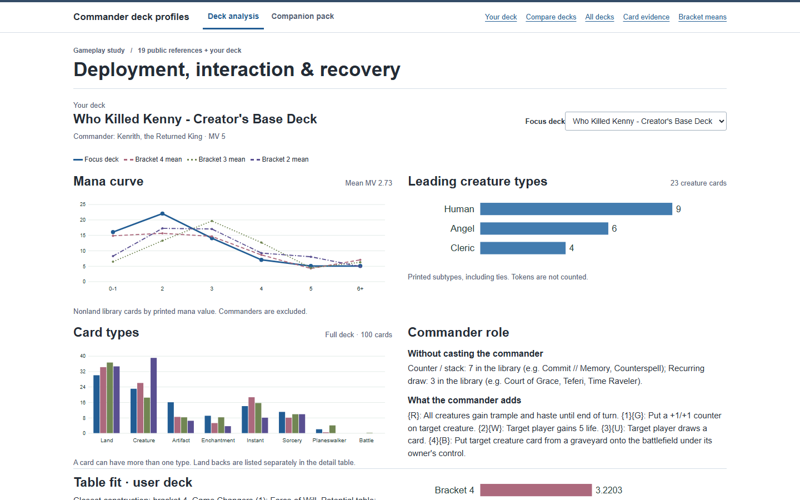

# The Archmage's Companion

**[Browse the MTG context pack](archmages-companion/)**. This folder contains only plain-text Markdown files. Read them directly on GitHub, no download or installation required. Use the pack to learn Magic yourself or give it to an agent to help with deckbuilding and turn-by-turn decisions.

The original code and context pack are [free for noncommercial use, modification, and sharing](LICENSE.md). This is unofficial fan content, not approved or endorsed by Wizards of the Coast. The project license does not grant rights to Magic or other third-party material.

## Commander deck comparison

Compare your deck with 19 saved public Commander lists using mana curves, card types, creature types, interaction, deployment, and recovery. The example player deck is Kenrith; replace it with your own list in the analysis notebook. The companion guide is on its own tab.

| Explore | Entry point |
| --- | --- |
| Interactive dashboard | [Open the live Commander dashboard](https://struckchris.github.io/magic-the-gathering-deckbuilding-companion/). To view it offline, open `index.html` with the repository folders together. |
| Analysis and code | [Compare a deck in Jupyter](compare_decks.ipynb) · [Render the Python dashboard](dashboards/python/build_dashboard.ipynb) · [Build the native workbooks](dashboards/build_native_workbooks.ipynb) |
| Compare the tools | [Open Compare tools](https://struckchris.github.io/magic-the-gathering-deckbuilding-companion/#compare-tools). Pick one of 15 charts and see Python, Tableau, and Power BI side by side, or switch between full-width views without changing the chart. The original images, Tableau workbook, and Power BI paginated report are linked from the tab. |
| Tableau workbook | [Packaged workbook with embedded data](dashboards/tableau/gameplay.twbx). |
| Power BI service | [Paginated report](<dashboards/power-bi/Commander Gameplay Comparison.rdl>) · [Rebuild it in Jupyter](dashboards/power-bi/build_paginated.ipynb). Import the RDL into your own workspace to view or export the 15 report pages. No account is needed to view the saved images. |
| Inputs and evidence | [Reference deck catalog](data/reference_decks.csv) · [Sample results](results/) |

No Python installation is needed to view the finished dashboard. To rerun the notebooks locally, use a Python 3.10 or 3.11 environment, run `python -m pip install -r requirements.txt`, then `jupyter lab`. Start with the root notebook and set `user_deck_path` to your list. The public references remain unchanged.

**Compare tools is an image reference only.** Its 45 images show the same published 20-deck sample in Python, Tableau, and Power BI. Adding your own deck changes **Deck analysis** when you rerun the notebooks; it does not change these images. The sample dashboard and images work offline and do not connect to the author's Tableau or Power BI account.

## Test Decks

The [reference catalog](data/reference_decks.csv) records 19 public lists saved on November 18, 2026: five player-built decks in each of brackets 2, 3, and 4, plus four stock precons counted separately. Each local text file contains the commander and the other 99 cards, with quantities. Brackets describe the individual builds, not the commanders.

### Popular commanders

On November 18, 2026, we checked [EDHREC's overall ranking](https://edhrec.com/commanders) (past two years, all brackets) and selected one player-built list for each of ranks 1-10. The bracket links show where EDHREC indexed each list. For ranks 5-10 we chose builds that balance the full sample across brackets; the mix is not an estimate of how often each commander is played at each bracket. Each saved list links to its EDHREC preview and the original deck. The catalog leaves the author blank if the builder could not be verified.

| Overall rank | Saved list | Source bracket | Published deck |
| --- | --- | --- | --- |
| 1 | [Y'shtola, Night's Blessed](<data/public/player-built/Yshtola.txt>) | [3](https://edhrec.com/commanders/yshtola-nights-blessed/upgraded/decks) | [EDHREC list](https://edhrec.com/deckpreview/_wnLfYTGufrMQ1JjASzAxQ) / [Original](https://archidekt.com/decks/19956440) |
| 2 | [Edgar Markov](<data/public/player-built/Edgar Markov.txt>) | [2](https://edhrec.com/commanders/edgar-markov/core/decks) | [EDHREC list](https://edhrec.com/deckpreview/pgu10MwR6pMGTdVtlISwZA) / [Original](https://archidekt.com/decks/15099118) |
| 3 | [The Ur-Dragon](<data/public/player-built/The Ur-Dragon.txt>) | [2](https://edhrec.com/commanders/the-ur-dragon/core/decks) | [EDHREC list](https://edhrec.com/deckpreview/D-Aoq6GsG07ubX5bBoXTqw) / [Original](https://moxfield.com/decks/EBKgAZj6YHWvkK8H5D8U6w) |
| 4 | [Atraxa, Praetors' Voice](<data/public/player-built/Atraxa.txt>) | [3](https://edhrec.com/commanders/atraxa-praetors-voice/upgraded/decks) | [EDHREC list](https://edhrec.com/deckpreview/-HTXAsT7ofABq6qLPqXh6w) / [Original](https://archidekt.com/decks/13768970) |
| 5 | [Krenko, Mob Boss](<data/public/player-built/Krenko.txt>) | [2](https://edhrec.com/commanders/krenko-mob-boss/core/decks) | [EDHREC list](https://edhrec.com/deckpreview/_x_ztcQooYfruFZsAfeVZQ) / [Original](https://moxfield.com/decks/2ZGfAepQ7nCgta11qqqx3g) |
| 6 | [Vivi Ornitier](<data/public/player-built/Vivi.txt>) | [4](https://edhrec.com/commanders/vivi-ornitier/optimized/decks) | [EDHREC list](https://edhrec.com/deckpreview/MJ282w-9zl2IunUheXzeFA) / [Original](https://archidekt.com/decks/21763174) |
| 7 | [Sauron, the Dark Lord](<data/public/player-built/Sauron.txt>) | [2](https://edhrec.com/commanders/sauron-the-dark-lord/core/decks) | [EDHREC list](https://edhrec.com/deckpreview/JT2s4k-GkD92GBCUH-o7Jw) / [Original](https://moxfield.com/decks/vSdblLT9IEu3xEtO60ep3Q) |
| 8 | [Teval, the Balanced Scale](<data/public/player-built/Teval.txt>) | [3](https://edhrec.com/commanders/teval-the-balanced-scale/upgraded/decks) | [EDHREC list](https://edhrec.com/deckpreview/sqY-NVvxoymEoiBY5V6fzw) / [Original](https://archidekt.com/decks/25942216) |
| 9 | [Kaalia of the Vast](<data/public/player-built/Kaalia.txt>) | [4](https://edhrec.com/commanders/kaalia-of-the-vast/optimized/decks) | [EDHREC list](https://edhrec.com/deckpreview/waapHuE9rqueCMvJc3F1Jw) / [Original](https://moxfield.com/decks/9PLdvv0moEWn5WPoJ5UzHQ) |
| 10 | [Fire Lord Azula](<data/public/player-built/Azula.txt>) | [4](https://edhrec.com/commanders/fire-lord-azula/optimized/decks) | [EDHREC list](https://edhrec.com/deckpreview/Ah8hDejKaMST0iBTkg7Uvg) / [Original](https://moxfield.com/decks/R7q7JZN6eU-UDFzx9AqqXg) |

### Published deck techs

| Bracket | Saved player-built list | Author and source |
| --- | --- | --- |
| 2 | [Witherbloom, the Balancer](data/public/player-built/Witherbloom.txt) | [Bennie Smith, deck tech](https://edhrec.com/articles/witherbloom-the-balancer-commander-deck-tech) |
| 3 | [Namor the Sub-Mariner](data/public/player-built/Namor.txt) | [Cooper Gottfried, deck tech](https://edhrec.com/articles/a-deck-tech-for-marvels-first-mutant-namor-the-sub-mariner) |
| 3 | [Suki, Kyoshi Warrior](data/public/player-built/Suki.txt) | [John Sherwood, Bracket 3 build](https://edhrec.com/articles/suki-kyoshi-warrior-bracket-3-commander-deck-tech) |
| 4 | [Yeva, Nature's Herald](data/public/player-built/Yeva.txt) | [Jeff Girten, optimized Yeva list](https://edhrec.com/articles/adapting-your-decks-to-the-optimized-bracket-4) |
| 4 | [Kalamax, the Stormsire](data/public/player-built/Kalamax.txt) | [Jeff Girten, optimized Kalamax list](https://edhrec.com/articles/adapting-your-decks-to-the-optimized-bracket-4) |

### Stock precons

The four stock *Lost Caverns of Ixalan* lists are a separate precon subgroup. Their source is [Wizards' published decklists](https://magic.wizards.com/en/news/announcements/the-lost-caverns-of-ixalan-commander-decklists); the catalog leaves their brackets blank.

| Saved precon list | Commander | Tribe |
| --- | --- | --- |
| [Ahoy Mateys](<data/public/Ahoy Mateys.txt>) | Admiral Brass, Unsinkable | Pirates |
| [Blood Rites](<data/public/Blood Rites.txt>) | Clavileño, First of the Blessed | Vampires |
| [Explorers of the Deep](<data/public/Explorers of the Deep.txt>) | Hakbal of the Surging Soul | Merfolk |
| [Veloci-Ramp-Tor](data/public/Veloci-Ramp-Tor.txt) | Pantlaza, Sun-Favored | Dinosaurs |

**Your deck is separate.** [Who Killed Kenny? (Creator's Base Deck)](<data/comparison/Who Killed Kenny - Creator's Base Deck.txt>) is the replaceable Kenrith input, not a public reference deck. Set `user_deck_path` in [compare_decks.ipynb](compare_decks.ipynb) to compare another deck. To change a reference list, save a copy under a new filename and update its catalog row; this preserves the published snapshot.

## Analysis Direction

**Across the decks** starts with the printed mana curve. Use **Select a chart** to switch charts, or **View all charts** to see all 15 together. The gallery starts with printed curve, deployment routes, interaction targets, interaction methods and recovery, followed by color, card type, creature type and other gameplay comparisons. **Deck group** applies to either mode and retains the player deck. The downloadable Power BI paginated report has one page per chart.

**Dashboard data:** The 15 shared views use the same [card counts](results/strategy_cells.csv). The player is first, followed by B4, B3, B2 and stock precons. This is a display order, not a power ranking. For context beyond the counts, the Python dashboard also shows [deck routes](results/deck_routes.csv), [card evidence](results/strategy_card_evidence.csv), and [bracket means](results/cohort_measures.csv). Bracket means exclude the player and precons.

**Compare another list:** Run [the support notebook](compare_decks.ipynb) from this folder, with `user_deck_path` set to an English quantity/name list with `Commander` and `Deck` headings. The notebook uses [Scryfall card data](https://scryfall.com/docs/api/cards); it runs offline for the shipped inputs and needs internet access and `requests` for new names or a requested refresh. Regenerate the Python view with its [separate rendering notebook](dashboards/python/build_dashboard.ipynb). The [deck summaries](results/gameplay_profiles.csv) contain both playstyle notes; [card detail](results/gameplay_cards.csv) shows the cards behind each count. Notes are reviewed for the exact lists: replacing a list with a different one does not silently reuse its old interpretation.

**What the charts measure:** Deployment, interaction targets, interaction methods and recovery count distinct cards with a tagged capability, including the commander. Categories overlap. Tags use card-level annotations and conservative Oracle-text rules, not a simulation: select a count to inspect the evidence, not a promised outcome. Curve, card types and creature types count slots. Public role notes are tied to exact reference lists; the player summary is derived from the submitted library and commander.

| Question | Selected view | What to show |
| --- | --- | --- |
| Where does my deck ask me to spend mana? | Printed mana curve | Count nonland library cards at mana values 0-1, 2, 3, 4, 5, and 6+. Show the mean and the cards behind each bin. Display commander cost separately: a commander is available from a different zone, not drawn from the library. |
| What am I drawing, and what creature types do I actually support? | Card types and tribes | Show counts of lands, creatures, artifacts, enchantments, instants, sorceries, planeswalkers, and battles across the whole deck, including the commander. Beside them, show the three most frequent printed creature subtypes, retaining cutoff ties and linking to the cards. |
| What do those numbers miss about how the deck plays? | Short playstyle note | Identify what the commander contributes, how the list turns a resource into cards or pressure, and one condition that matters. Cite one or two cards actually in the list. Read the deployment and recovery counts with the cards that actually enable them. |

Compare the user's deck with a chosen reference list or the arithmetic mean of the five player-built lists in a selected bracket. Show the user's actual counts alongside the comparison. The bracket mean is context for a swap, not a target curve or land count; stock precons stay separate.

**Reading the counts:** Use library-face mana values (X is zero; split halves combine). Keep optional land backs separate from front-face lands. Type bars can overlap: an artifact creature counts in both bars, so they should not be stacked to 100. A Human Wizard counts as both types. Tokens and types granted by abilities do not inflate printed subtype counts.

**Examples of useful style notes:**

- [Kaalia](data/public/player-built/Kaalia.txt): An expensive Angel in hand is not necessarily a late cast. Attacking an opponent lets Kaalia put Avacyn, Angel of Hope onto the battlefield from hand; Reanimate offers another route if Avacyn is in the graveyard. Keep the printed curve intact and explain how the deck can bypass it.
- [Krenko](data/public/player-built/Krenko.txt): The creature count tells you how many bodies are in the list, not how many the deck can produce. Krenko can tap to make one token for each Goblin you control. Goblin Chieftain gives Krenko haste, and Skirk Prospector can turn the resulting tokens into mana.

Exact-name overlap remains available in the supporting data. It is not a headline gameplay metric: decks can fill the same roles with different cards. Collection history, printings, prices, and personal power rankings are outside this comparison.

## Current Status

### Reading the table estimate

The public sample is balanced by design, not a survey of Commander. The fit table compares the user with the five player-built decks per bracket. It averages the absolute differences in the six curve-bin shares (percentage of library nonlands) and the eight type densities (percentage of the whole deck), then weights those two families equally. A smaller gap means a closer construction profile, not a higher chance of winning. Displayed curve bars/cells are card counts. Bracket means give each deck equal weight; mean tribe counts include zeros for decks without the subtype.

The same calculation runs for every player input. It reports the closest construction profile, flags Game Changers separately, and suggests a potential table. A close bracket 4 match is not a finding that the deck is optimized. It does not measure win timing, tutor consistency or pilot intent. The published builders’ bracket labels are reference points, not recertifications.

**Rebuild:** Run `compare_decks.ipynb` in the project root, then [render the browser dashboard](dashboards/python/build_dashboard.ipynb) from its own folder. To rebuild the other tools from those results, use the [Tableau build notebook](dashboards/build_native_workbooks.ipynb) from `dashboards` and the [Power BI paginated report notebook](dashboards/power-bi/build_paginated.ipynb) from the project root. Neither requires the Power BI Desktop project folders.
